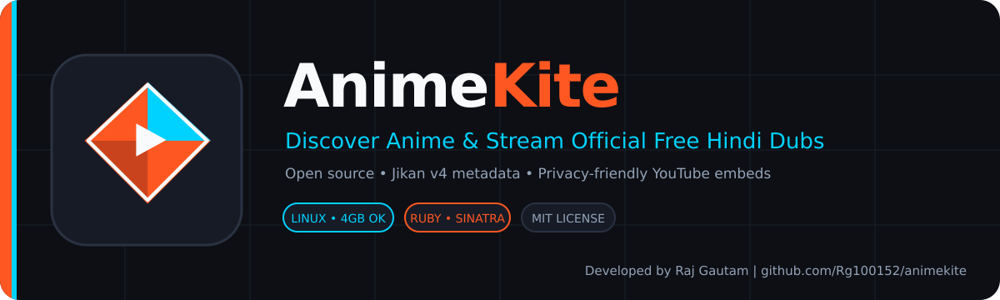

<p align="center">
  
</p>

<p align="center">
  
</p>

# AnimeKite

**Open-source anime discovery & legal Hindi-dub hub** — Python Flask edition.

Built by **Raj Gautam (Open Source Lover)** for Linux desktops such as Pop!_OS with 4 GB RAM. Anime cards render instantly from a built-in verified catalog; live rankings, scores and posters are added by the free [Jikan v4 API](https://jikan.moe/) when the network is available. Streams are embedded only from official distributors such as [Muse India](https://www.youtube.com/@MuseIndiaChannel/playlists). No piracy, no scraping, no API keys, no database.

[🔗 GitHub repository](https://github.com/Rg100152/animekite) · [📄 Software Design Document](DESIGN.md) · [⚖️ MIT License](LICENSE)

---

## Screenshot


---

## Features

- **Instant first paint** — curated Hindi-dub catalog with locally generated SVG posters; never an empty screen.
- **Discovery + legal streams** — Jikan v4 metadata and official `youtube-nocookie.com` embeds from authorized channels.
- **Live search & filters** — All Anime, Hindi Dubbed (Official Free), Top Airing, Popular Movies, My Watchlist.
- **Theater modal** — official video player, synopsis, score, episode count, studio, licence note and watchlist toggle.
- **Local watchlist** — saved in browser `localStorage`; no account or tracking.
- **Lightweight** — 15-minute in-memory TTL cache, rate-limited requests, 4-second timeouts, zero CSS animations, lazy-loaded images.
- **Original branding** — custom SVG logo and 1200×360 promotional banner.

---

## Installation guide

### Prerequisites

| Requirement | Check command | Notes |
| --- | --- | --- |
| Python 3.8+ | `python3 --version` | Python 3.10+ recommended |
| pip | `python3 -m pip --version` | Included with most Python installs |
| Git | `git --version` | Only needed to clone the repository |
| Internet | — | Optional; offline fallback catalog still works |

### 1. Linux (Ubuntu / Pop!_OS / Debian / Fedora)

```bash
# Debian/Ubuntu/Pop!_OS
sudo apt update
sudo apt install -y python3 python3-venv python3-pip git

# Fedora (instead of apt)
# sudo dnf install -y python3 python3-pip git

git clone https://github.com/Rg100152/animekite.git
cd animekite

python3 -m venv .venv
source .venv/bin/activate
python -m pip install --upgrade pip
pip install -r requirements.txt

python app.py
```

Open <http://127.0.0.1:5000> in your browser.

### 2. macOS

```bash
brew install python git          # if not already installed

git clone https://github.com/Rg100152/animekite.git
cd animekite

python3 -m venv .venv
source .venv/bin/activate
python -m pip install --upgrade pip
pip install -r requirements.txt

python app.py
```

Open <http://127.0.0.1:5000>.

### 3. Windows (PowerShell)

```powershell
git clone https://github.com/Rg100152/animekite.git
cd animekite

py -3 -m venv .venv
.\.venv\Scripts\Activate.ps1
python -m pip install --upgrade pip
pip install -r requirements.txt

python app.py
```

If PowerShell blocks the virtual environment activation, run this once first:

```powershell
Set-ExecutionPolicy -Scope Process -ExecutionPolicy Bypass
```

Open <http://127.0.0.1:5000>.

### Quick start without a virtual environment

```bash
pip install -r requirements.txt
python3 app.py
```

### 4. Verify the installation

```bash
python3 -m py_compile app.py
curl http://127.0.0.1:5000/api/anime?category=hindi
```

You should see a JSON list containing `Attack on Titan`, `One-Punch Man`, `DAN DA DAN`, `Naruto (Official Hindi Dub)` and other curated titles.

### 5. Configuration (optional)

The server binds to `0.0.0.0:5000` by default. Change it with environment variables:

```bash
PORT=8080 python3 app.py
HOST=127.0.0.1 python3 app.py
```

Windows PowerShell:

```powershell
$env:PORT = "8080"; python app.py
```

Press **Ctrl+C** in the terminal to stop the server.

### Troubleshooting

| Problem | Fix |
| --- | --- |
| `python: command not found` | Use `python3 app.py` on Linux/macOS, or `py -3 app.py` on Windows. |
| Port 5000 already in use | Use `PORT=8080 python3 app.py` and open `http://127.0.0.1:8080`. |
| Jikan requests time out | Normal offline behaviour — the built-in catalog is shown automatically. |
| Blank posters | Hard-refresh the browser (`Ctrl+F5`); local SVG posters are served from `/poster/<id>.svg`. |
| `pip` permission errors | Use a virtual environment as shown above. |

---

## API endpoints

| Endpoint | Description |
| --- | --- |
| `GET /api/anime?category=hindi` | Curated official Hindi-dubbed catalog (instant) |
| `GET /api/anime?category=airing` | Top airing anime from Jikan, with catalog fallback |
| `GET /api/anime?category=movies` | Popular movies from Jikan, with catalog fallback |
| `GET /api/anime?q=naruto` | Jikan title search (SFW), with local fallback |
| `GET /api/metadata?q=title` | Cached poster/score lookup for one title |
| `GET /poster/<id>.svg` | Locally generated SVG poster |

---

## Project structure

```
animekite/
├── app.py                  Flask backend, TTL cache, Jikan client
├── requirements.txt        flask, requests
├── DESIGN.md               Software Design Document
├── README.md               This file
├── LICENSE                 MIT License (2026 Raj Gautam)
├── data/hindi_dubs.json    Curated official Hindi-dubbed embeds
├── docs/screenshot.png     Application screenshot
├── static/
│   ├── css/style.css
│   ├── js/app.js
│   └── images/             Logo, banner, placeholder poster
└── templates/index.html
```

---

## Legal note

Jujutsu Kaisen, Demon Slayer, Frieren and Solo Leveling appear as discovery entries with links to their licensed platform (Crunchyroll); no unofficial YouTube uploads are embedded. Hindi-dub streams are embedded only from verified official channels. Anime titles, posters and imagery belong to their respective rights holders. See [DESIGN.md](DESIGN.md) for the full SDD.

## License

[MIT License](LICENSE) © 2026 Raj Gautam.
